  

  

  I focus on how products feel and function. Bridging design systems, creative direction, and modern AI prototyping to ship real, usable MVPs without slow boilerplate.

---

<b>🔭 COSMIC TELEMETRY</b> ecosystem &amp; repository star map

  

---

<b>✦ BRIGHTEST STARS</b> what i'm building, managing &amp; contributing to

🏗️  **[MorData](https://mordata.io):** Sovereign registry & enterprise discovery infrastructure. 

🌌  **[Glass&Void](https://www.glassandvoid.com):** Optical intelligence hub & field companion for photographers. 

〰️  **[WVFM Labs](https://wvfmlabs.com):** Creative studio house producing client products, media, and visual systems. 

🛸  **[Moonizen](https://moonizens.com) / [Moonizen Studios](https://moonizenstudios.com):** Contributing to studio production, creative strategy, and digital experiences. 

🧩  **Sandbox Projects:** AI-driven UI patterns, utility tools, and design-led MVPs.

---

<b>🧭 INTERACTIVE BREAKDOWN</b> tap to expand or collapse

  
⚡ <strong>Core Capabilities &amp; Focus</strong>

   
  
  🎯 <strong>UI/UX Architecture:</strong> End-to-end user flows, interactive wireframes, and scalable interface systems. 
  
  🪩 <strong>Creative Direction:</strong> Brand identity, bespoke vector systems, and cohesive product storytelling. 
  
  ⚡ <strong>Rapid AI Prototyping:</strong> Translating complex product logic into functional MVPs with AI-assisted workflows. 
  
  🛠️ <strong>Product Production:</strong> Technical scoping, asset pipelines, and hands-on studio delivery from concept to launch.

  
🧰 <strong>Creative &amp; AI Build Stack</strong>

   

| Domain | Tools &amp; Platforms |
| :--- | :--- |
| **Design &amp; UI/UX**  | Figma, Visme, Hand-Coded SVG Systems |
| **AI Prototyping**  | Grok, Google AI Studio, OpenAI Codex |
| **Studio &amp; Production**  | GitHub Workflows, Asset Pipelines, WVFM Labs |

---

  <i>"Focusing on utility, visual precision, and seamless user experiences."</i> 

  
  
  
  

  
  
  

  
   
  <i>Zero-vocal electronic &amp; ambient for multi-hour builds</i>

  

---

## 🛠️ Use This Template

Built with custom hand-coded SVGs (`#05070D` / `#334480` / `#8DA2FF`)—no third-party stat trackers, rate-limited metric cards, or bloated badge walls.

1. **[Fork this repository](https://github.com/morgan-mordata/morgan-mordata/fork)** and rename it to match your GitHub username.
2. Follow the **[SVG & Asset Customization Guide](./CUSTOMIZE.md)** to swap node labels, audio metadata, and colors.
3. Update the bio, project links, and destination URLs in [`README.md`](./README.md) with your own.

Just want the star map? Copy [`galaxy.svg`](./galaxy.svg) standalone into your existing profile repo. Released under the **[MIT License](./LICENSE)**.
